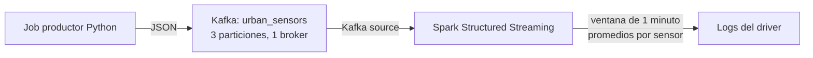

# Infraestructura base e ingesta Kinesis

Este repositorio contiene la configuración Terraform para la infraestructura base y la ingesta Kinesis → Firehose → S3. El código está validado localmente. El plan documentado es una propuesta de Terraform: **no significa que los recursos de este checkpoint estén desplegados**. La prueba real de entrega a S3 queda pendiente hasta aplicar el plan en una cuenta AWS autorizada.

La configuración define:

- Una VPC con dos subredes privadas en Availability Zones distintas y sin rutas a Internet.
- Un S3 Gateway Endpoint asociado a la tabla de rutas privada para acceder a S3 sin NAT Gateway.
- Un bucket de Data Lake cuyo nombre se construye con el ID de la cuenta, con bloqueo de acceso público, cifrado SSE-S3 y versionado.
- Un rol de procesamiento asumible por Lambda o Managed Service for Apache Flink, limitado a listar y leer/escribir objetos bajo `raw/`.
- Un rol del plano de control con acciones explícitas de solo lectura para auditoría.
- Un Kinesis Data Stream provisionado con dos shards y cifrado KMS, conectado a Firehose para entregar datos a `raw/kinesis/` en S3.
- Un rol dedicado de Firehose con permisos limitados al stream, la clave KMS, el prefijo del Data Lake y sus logs de CloudWatch.
- Un backend remoto S3 cifrado y locking con DynamoDB.

## Estructura

```text
modules/
  network/       VPC, subredes, tablas de rutas y endpoint S3
  identity/      Roles y políticas IAM
  kinesis/       Stream cifrado, rol Firehose y entrega a S3
environments/
  dev/           Configuración del entorno, backend, variables y outputs
```

## Prerrequisitos

- Terraform `>= 1.5.0`.
- AWS CLI configurado con credenciales para crear los recursos indicados y consultar la identidad de la cuenta.
- Una cuenta AWS y una región con al menos dos Availability Zones disponibles.

El backend S3 debe existir **antes** de ejecutar `terraform init`. El bucket configurado en `environments/dev/backend.tf` debe ser globalmente único. Si cambiás su nombre o región, actualizá también los comandos de bootstrap y el archivo de backend.

## Bootstrap del backend (una sola vez)

Los siguientes comandos usan PowerShell y la región `us-east-2` configurada en este ejemplo. Ejecutalos con una identidad de AWS autorizada para crear y administrar estos recursos:

```powershell
$env:AWS_PROFILE = "dev"
$Bucket = "tfstate-datalake-dev-coder"
$Region = "us-east-2"
$Table = "terraform-locks-dev"

aws sso login --profile dev
aws sts get-caller-identity --profile dev
aws s3api create-bucket --bucket $Bucket --region $Region --create-bucket-configuration LocationConstraint=$Region --profile dev
aws s3api put-public-access-block --bucket $Bucket --region $Region --public-access-block-configuration BlockPublicAcls=true,IgnorePublicAcls=true,BlockPublicPolicy=true,RestrictPublicBuckets=true --profile dev
aws s3api put-bucket-versioning --bucket $Bucket --region $Region --versioning-configuration Status=Enabled --profile dev
@'
{
  "Rules": [
    {
      "ApplyServerSideEncryptionByDefault": {
        "SSEAlgorithm": "AES256"
      }
    }
  ]
}
'@ | Set-Content -Path .\sse-config.json -Encoding Ascii

aws s3api put-bucket-encryption --bucket $Bucket --region $Region --server-side-encryption-configuration file://sse-config.json --profile dev
if ($LASTEXITCODE -ne 0) { throw "No se pudo configurar el cifrado del bucket." }
Remove-Item .\sse-config.json
aws dynamodb create-table --table-name $Table --region $Region --attribute-definitions AttributeName=LockID,AttributeType=S --key-schema AttributeName=LockID,KeyType=HASH --billing-mode PAY_PER_REQUEST --sse-specification Enabled=true --profile dev
aws dynamodb wait table-exists --table-name $Table --region $Region --profile dev
```

El nombre del bucket S3 debe ser único en todo AWS. Si el comando `create-bucket` informa que ya existe o pertenece a otra cuenta, elegí otro nombre y actualizá `backend.tf`. No elimines el bucket ni la tabla mientras haya estados Terraform que dependan de ellos.

Para configurar el perfil SSO `dev` en AWS CLI, ejecutá `aws configure sso --profile dev` y seleccioná la cuenta de laboratorio y un conjunto de permisos autorizado. No crees claves permanentes para el usuario raíz. Confirmá la cuenta activa con `aws sts get-caller-identity --profile dev` antes de crear recursos.

## Inicializar y validar

Desde la raíz del repositorio:

```powershell
$env:AWS_PROFILE = "dev"
aws sso login --profile dev
terraform -chdir=environments/dev init
terraform fmt -check -recursive
terraform -chdir=environments/dev validate
terraform -chdir=environments/dev plan -out=tfplan
```

Para aplicar después de revisar el plan:

```powershell
terraform -chdir=environments/dev apply tfplan
```

También podés copiar `environments/dev/terraform.tfvars.example` como `environments/dev/terraform.tfvars` y ajustar los valores para tu cuenta/región. Los archivos `.tfvars` con valores locales no se suben al repositorio.

## Probar la ingesta Kinesis → Firehose → S3

Después de desplegar la infraestructura y configurar el perfil SSO `dev`, enviá un evento de prueba desde PowerShell:

```powershell
$event = '{"event":"kinesis-checkpoint","source":"aws-cli"}'
$encodedEvent = [Convert]::ToBase64String([Text.Encoding]::UTF8.GetBytes($event))
aws kinesis put-record --stream-name data-ingestion-dev --partition-key test-001 --data $encodedEvent --region us-east-2 --profile dev
```

Esperá más de 60 segundos para permitir que Firehose vacíe su buffer. Luego listá los objetos entregados; el nombre del bucket se obtiene de los outputs de Terraform:

```powershell
$bucketArn = terraform -chdir=environments/dev output -raw data_lake_bucket_arn
$bucketName = $bucketArn.Split(':')[-1]
aws s3 ls "s3://$bucketName/raw/kinesis/" --recursive --region us-east-2 --profile dev
```

La salida del último comando debe mostrar un objeto generado por Firehose bajo `raw/kinesis/`. Guardá esa salida o una captura como evidencia después de ejecutar la prueba real; no inventes una salida si todavía no desplegaste los recursos. Kinesis provisionado, Firehose, S3, KMS y CloudWatch pueden generar cargos mientras estén activos.

El proveedor de Terraform modela esta entrega con `destination = "extended_s3"` y `extended_s3_configuration`, que es el destino S3 con opciones adicionales de buffering y logging. Firehose sigue escribiendo objetos normales en el bucket de S3.

Para completar la evidencia funcional solicitada por el checkpoint, adjuntá la salida real de `aws s3 ls` o una captura donde se vea el objeto generado en `raw/kinesis/`. Esta prueba requiere desplegar los recursos, enviar el evento y esperar la entrega de Firehose. Todavía no se realizó; no presentes una salida simulada como evidencia.

El bucket del Data Lake tiene versionado. `aws s3 rm --recursive` crea marcadores de borrado y no elimina permanentemente las versiones anteriores, por lo que `terraform destroy` puede fallar al intentar borrar el bucket. Antes de destruirlo, verificá que contenga solo datos de este laboratorio. En la consola S3, abrí ese bucket, elegí **Vaciar** y confirmá la eliminación de todos los objetos, versiones y marcadores. Esto es permanente; no lo hagas si el bucket contiene datos que quieras conservar. Luego comprobá que esté vacío y ejecutá:

```powershell
terraform -chdir=environments/dev destroy
```

## Roles IAM y alcance

- `data_processing_role_arn`: rol asumible por Lambda y Managed Service for Apache Flink. Puede ejecutar `s3:ListBucket` solo con el prefijo `raw/`, y `s3:GetObject`/`s3:PutObject` sobre objetos dentro de ese prefijo. Si otro servicio lo va a asumir, agregá su principal de servicio a la trust policy y revisá sus permisos específicos.
- `control_plane_audit_role_arn`: rol de auditoría. Su trust policy permite la asunción desde la cuenta AWS donde se despliega; el principal que lo asuma también necesita permiso `sts:AssumeRole`. La política enumera acciones de lectura y no permite cambios. Algunas APIs de lectura de AWS no admiten limitar el recurso y por eso requieren `Resource = "*"`, pero no hay acciones IAM comodín.

Los outputs de red incluyen `vpc_id`, `private_subnet_ids` y `s3_endpoint_id`. Los outputs del entorno exponen los ARN necesarios para integrar estos recursos en entregas posteriores.

## Evidencia del plan

`PLAN_OUTPUT.md` contiene la salida del plan actual de esta configuración: 23 recursos por crear, ninguno por cambiar ni destruir. Es una propuesta de Terraform, no evidencia de que se haya aplicado. El ID de cuenta se reemplazó por un marcador en las dos apariciones de la salida antes de publicar el archivo.

## Higiene del repositorio

El `.gitignore` excluye el directorio local `.terraform/`, los estados y los archivos `.tfvars`. El archivo `.terraform.lock.hcl` se versiona para mantener fijadas las versiones exactas de los proveedores.

## Pre-entrega 3: procesamiento urbano en tiempo real

Esta parte agrega un entorno **local** de Kubernetes para practicar Kafka y Spark Structured Streaming. No crea recursos en AWS. La arquitectura usa un único broker Kafka en modo KRaft, un productor Python finito y una aplicación Spark que agrupa eventos en ventanas de un minuto.



### Alcance y limitaciones

- Kafka, productor y Spark se ejecutan dentro del namespace `urban-streaming`.
- Los servicios de Kafka son `ClusterIP`; no se publica el broker fuera del clúster.
- `app-config` contiene el tópico, el bootstrap server y los parámetros del productor y Spark. `kafka-config` contiene la configuración no secreta del broker.
- El productor envía 180 eventos, uno por segundo, con timestamps UTC. El job de Spark calcula promedios de temperatura y calidad del aire por sensor en ventanas de un minuto.
- Spark usa un watermark de 10 segundos y guarda el checkpoint en un PVC. La imagen incluye el conector Kafka compatible con Spark 3.5.5 y Scala 2.12.
- **Un solo broker no ofrece alta disponibilidad ni tolerancia a la caída del broker.** Esta configuración sin autenticación es exclusivamente para el clúster local de práctica, no para producción.
- Docker Desktop debe tener Kubernetes habilitado y recursos suficientes. Como punto de partida, asigná al menos 4 CPU y 6 GiB de memoria al entorno de Docker Desktop, y verificá que exista una StorageClass por defecto para los PVC.

### Requisitos

- Docker Desktop con Kubernetes habilitado.
- Docker CLI y `kubectl`.
- Conexión a Internet durante la primera construcción para descargar imágenes base y dependencias Maven.
- Contexto Kubernetes de Docker Desktop seleccionado. Los manifiestos usan `imagePullPolicy: Never` para las imágenes locales del productor y Spark.

Verificá que el clúster activo sea el local antes de aplicar manifiestos:

```powershell
kubectl config current-context
kubectl get nodes
```

No continúes si el contexto no corresponde a Docker Desktop.

### Construcción y despliegue

Desde la raíz del repositorio, construí las imágenes localmente:

```powershell
docker build -t urban-producer:1.0 .\producer
docker build -t urban-spark:3.5.5 .\spark
```

Creá el namespace y desplegá la configuración, Kafka y el checkpoint:

```powershell
kubectl apply -f .\k8s\namespace.yaml
kubectl apply -f .\k8s\configmap.yaml
kubectl apply -f .\k8s\kafka.yaml
kubectl apply -f .\k8s\spark-checkpoint-pvc.yaml
kubectl apply -f .\k8s\spark-rbac.yaml
kubectl rollout status statefulset/kafka -n urban-streaming --timeout=300s
kubectl wait --for=jsonpath='{.status.phase}'=Bound pvc/spark-checkpoint -n urban-streaming --timeout=180s
```

Creá el tópico y comprobá que tenga tres particiones:

```powershell
kubectl apply -f .\k8s\kafka-topic-job.yaml
kubectl wait --for=condition=complete job/create-kafka-topic -n urban-streaming --timeout=300s
kubectl exec -n urban-streaming kafka-0 -- /opt/kafka/bin/kafka-topics.sh --bootstrap-server kafka:9092 --describe --topic urban_sensors
```

Iniciá Spark primero. Esperá a que aparezca el pod del driver antes de enviar eventos:

```powershell
kubectl apply -f .\k8s\spark-job.yaml
kubectl get pods -n urban-streaming -w
```

En otra terminal, ejecutá el productor y esperá que termine:

```powershell
kubectl apply -f .\k8s\producer-job.yaml
kubectl wait --for=condition=complete job/urban-sensor-producer -n urban-streaming --timeout=300s
```

### Verificación y evidencia

Revisá los eventos enviados por el productor:

```powershell
kubectl logs -n urban-streaming job/urban-sensor-producer
```

Buscá el pod Spark driver y seguí sus logs. La salida de consola debe mostrar ventanas cerradas, el `sensor_id` y los dos promedios:

```powershell
kubectl get pods -n urban-streaming -l spark-role=driver
$DriverPod = kubectl get pods -n urban-streaming -l spark-role=driver -o jsonpath='{.items[0].metadata.name}'
kubectl logs -n urban-streaming $DriverPod
```

Conservá en esta sección logs o capturas **obtenidos de una ejecución real**. La agregación en modo append aparece cuando el watermark supera el final de la ventana; puede haber una demora mientras Spark procesa eventos y cierra las ventanas. No copies salidas inventadas como evidencia.

### Limpieza local

Cuando termines de revisar los logs, eliminá el namespace para detener Kafka, Spark y el productor:

```powershell
kubectl delete namespace urban-streaming
```

El PVC y los recursos de almacenamiento asociados también se eliminan según la política de la StorageClass local. Este comando afecta solo a este entorno local; verificá el contexto de `kubectl` antes de ejecutarlo.
